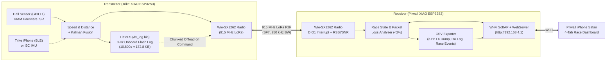

# ASME e-HPVC Telemetry & Race Management System (MAE 495 Final Project)

A long-range 915 MHz LoRa telemetry, **3-hour onboard flash data-logging**, Kalman-fused track localization, and mobile race-management system built for the **NC State University ASME Electric-Human Powered Vehicle Competition (e-HPVC)** trike.

---

## 1. Repository Structure

```text
495 Final Project/
├── README.md                              # Complete system documentation (this file)
├── dashboard_preview/
│   ├── iphone_dashboard_preview.html      # Standalone interactive iPhone Pitwall UI visualization
│   └── README.md                          # Guide to the iPhone UI, 4-tab layout, and Safari vs. PWA modes
└── test/
    ├── README.md                          # Instructions for hardware & BLE verification tests
    ├── test_ble_iphone/
    │   ├── test_ble_iphone.ino            # 20 Hz iPhone 17 BLE (Bluefruit Connect) Heading test
    │   └── compass_plotter.html           # Web Serial 2D Circular Compass + Rotating Arrow UI
    ├── test_zig_iphone/
    │   └── test_zig_iphone.ino            # 60 Hz iPhone 17 Wi-Fi UDP (ZIG SIM) Heading test
    ├── test_transmitter/
    │   └── test_transmitter.ino           # 10 Hz "Hello World #<n>" LoRa transmitter test sketch
    └── test_receiver/
        └── test_receiver.ino              # 10 Hz DIO1 interrupt LoRa receiver test sketch (RSSI/SNR/Delta)
```

---

## 2. System Hardware & Pinout

### Microcontrollers & Radio
* **2x Seeed Studio XIAO ESP32S3 + Wio-SX1262 (B2B Connector)**
  * **Transmitter Node (On the Trike):** Reads the Hall effect wheel speed sensor, runs dead-reckoning + Kalman sensor fusion, logs up to **3 hours (10,800 seconds)** of telemetry to internal Flash (`LittleFS`), and transmits packets over 915 MHz LoRa.
  * **Receiver Node (In the Pitwall):** Receives LoRa telemetry, computes live packet loss ($<2\%$ target), hosts a standalone Wi-Fi Access Point (`ASME-Telemetry`), serves the mobile web dashboard (`http://192.168.4.1`), and exports `.csv` logs.
* **Power Supply:** 9V battery stepped down via a 9V $\rightarrow$ 5V regulator.
* **Wheel Speed Sensor:** HiLetgo 3.3V-compatible Hall effect sensor mounted to the rear wheel (triggers `HIGH` once per wheel revolution).

### XIAO ESP32S3 Pin Assignment (Transmitter & Receiver)

| Pin / Interface | ESP32S3 GPIO | Connected Hardware / Function |
| :--- | :--- | :--- |
| **B2B Internal** | `GPIO 38` | Wio-SX1262 `LORA_LDO_EN` (Power & RF Switch Enable, active `HIGH`) |
| **B2B Internal** | `GPIO 41` | Wio-SX1262 `NSS / CS` (SPI Chip Select) |
| **B2B Internal** | `GPIO 39` | Wio-SX1262 `DIO1` (Hardware Packet Interrupt) |
| **B2B Internal** | `GPIO 42` | Wio-SX1262 `NRST` (Radio Hardware Reset) |
| **B2B Internal** | `GPIO 40` | Wio-SX1262 `BUSY` (Radio Busy Status) |
| **B2B Internal** | `GPIO 7, 8, 9` | Wio-SX1262 Hardware SPI (`SCK`, `MISO`, `MOSI`) |
| **Header `D0`** | `GPIO 1` | **Hall Effect Wheel Speed Sensor** (`RISING` Hardware Interrupt in `IRAM`) |
| **Header `D4`** | `GPIO 5` (`SDA`) | **I²C Bus SDA** (Future INA238 Voltage/Current Sensor & Optional I²C IMU) |
| **Header `D5`** | `GPIO 6` (`SCL`) | **I²C Bus SCL** (Future INA238 Voltage/Current Sensor & Optional I²C IMU) |
| **Internal BLE** | Bluetooth 5.0 | Optional connection to a trike-mounted iPhone (*Bluefruit Connect*) for fused 9-DoF IMU & GPS |

---

## 3. Software Architecture & 3-Hour Flash Storage



### 3-Hour Onboard Flash Capacity (`LittleFS` on XIAO ESP32S3)
The XIAO ESP32S3 has **8 MB of onboard Flash** and **8 MB of PSRAM**:
* **Duration:** **3 hours ($10,800\text{ seconds}$)** of continuous endurance race logging before dumping.
* **Binary Record Size:** `16 bytes` per 1-second record (`seq_num`, `timestamp_s`, `speed_mph_x100`, `wheel_rpm`, `roll_x10`, `pitch_x10`, `yaw_deg`, `voltage_mv`, `current_ma`, `soc_pct`).
* **Total Flash Footprint for 3 Hours:**
  $$10,800\text{ records} \times 16\text{ bytes} = \mathbf{172.8\text{ KB}} \quad (<6\%\text{ of available LittleFS flash!})$$
* **Dual Logging Strategy for Fast + Complete Recovery:**
  1. **Transmitter Ground-Truth Log (`/tx_log.bin`):** Stores all 3 hours ($10,800\text{ records}$) on the trike so zero data is ever lost even if the trike goes behind an obstacle. Offloaded over LoRa in high-speed burst mode (`SF7 / 500 kHz`) when **Dump TX Log** is pressed.
  2. **Receiver Live Mirror Log (`/rx_log.csv`):** Simultaneously records every packet received at the pitwall during the 3-hour race so you can also download the pitwall CSV **instantly (<1 second)** over Wi-Fi at any time without waiting for an over-the-air dump.

---

## 4. Location Tracking & Kalman Sensor Fusion (0.25-Mile, 10-Turn Course)

### Why We Don't Blindly Trust 1 Hz GPS Within a Lap
Standard consumer GPS has a **$\pm 15\text{ to }30\text{ ft}$ ($5\text{–}10\text{ m}$) noise radius** and $1\text{–}2\text{ s}$ smoothing lag in corners. By contrast, over a single **0.25-mile ($1,320\text{ ft}$) lap** (~45–60 seconds):
* **50-Ft Calibrated Hall Wheel Speed Sensor:** $<0.5\%$ distance error and **zero random noise**.
* **Phone Gyro + Compass Heading:** $\sim 1^\circ\text{–}2^\circ$ error at $10\text{ Hz}$.
* **Total Dead-Reckoning Drift over 1 full lap:**
  $$\text{Drift}_{1\text{ lap}} \approx 1,320\text{ ft} \times \sin(1.5^\circ) \approx \mathbf{5\text{ to }12\text{ feet}}$$

Because **$5\text{–}12\text{ ft}$ of dead-reckoning drift is already much tighter than $\pm 25\text{ ft}$ of GPS noise**—and because pressing the **`LAP` button** resets drift back to $(0, 0)$ every $1,320\text{ ft}$—pulling the position heavily toward raw 1 Hz GPS would actually inject noise into a clean trace.

### The 3-Tier Variance-Weighted Kalman Filter

1. **Tier 1 — High-Frequency Dead Reckoning (10 Hz, 98–100% Weight Within a Lap):**
   * Integrates wheel-speed distance step ($\Delta s = v_{\text{wheel}} \cdot \Delta t$) along the fused IMU heading ($\psi$):
     $$x_{\text{pred}} = x + \Delta s \cdot \sin(\psi - \psi_{\text{bias}}), \quad y_{\text{pred}} = y + \Delta s \cdot \cos(\psi - \psi_{\text{bias}})$$
   * Dead-reckoning uncertainty variance grows slowly with distance driven:
     $$P_{k} = P_{k-1} + q \cdot \Delta s^2$$

2. **Tier 2 — Variance-Gated GPS Safety Net ($K = \frac{P}{P + R}$):**
   * Given GPS measurement variance $R \approx (25\text{ ft})^2 = 625\text{ ft}^2$, the Kalman gain is:
     $$K = \frac{P}{P + R}$$
   * **During a normal lap ($s_{\text{lap}} < 1,500\text{ ft}$):** $P \ll R$ ($P \approx 0\text{ to }100\text{ ft}^2$), so $K$ is gated to **$0.00\text{–}0.02$**. The trace remains 98–100% smooth wheel + IMU dead reckoning with zero GPS jitter.
   * **Missed-Lap Safety Net ($s_{\text{lap}} > 1,600\text{ ft}$):** Only if the pit crew forgets to press the `LAP` button for multiple laps does $P$ grow large enough to open the GPS gate ($K \rightarrow 0.10\text{–}0.20$) to bound multi-lap drift.

3. **Tier 3 — Manual `LAP` Button Loop-Closure & Compass Bias Auto-Calibration:**
   * Pressing **`🏁 LAP`** when the trike crosses the Start/Finish line snaps the position back to the dropped **Start/Finish Pin $(0, 0)$** and resets uncertainty ($P \leftarrow 0$):
     $$x \leftarrow x_{\text{pin}}, \quad y \leftarrow y_{\text{pin}}, \quad P \leftarrow 0$$
   * Furthermore, the endpoint error vector $(\Delta x_{\text{end}}, \Delta y_{\text{end}})$ right before snapping reveals any slight compass mounting offset, allowing the filter to update $\psi_{\text{bias}}$ so the *next* lap traces even more accurately!

---

## 5. Pitwall iPhone Web Dashboard Preview

Open [`dashboard_preview/iphone_dashboard_preview.html`](file:///c:/Users/Srinivas/Documents/Arduino/495%20Final%20Project/dashboard_preview/iphone_dashboard_preview.html) in any browser to interact with the vertical iPhone UI prototype.

### The 4-Tab Mobile Interface (Locked 19.5:9 iPhone Aspect Ratio)
1. **`🏁 Race & Map` Tab:**
   * Persistent top bar with **Running Race Timer** (`00:14:22`), `PAUSE` toggle, active driver badge, lap counter, and live LoRa RSSI / Packet Loss %.
   * **1-Second Average Wheel Speed** hero display (`MPH`, `FT/S`, `RPM`, total miles, and lap feet).
   * **Interactive 10-Turn Track Map:** Speed-colored racing line (Green = fast straight, Amber/Red = slow turn), raw 1 Hz GPS comparison dots, **`📍 Drop Pin`** button to place the Start/Finish line anywhere on the course, and **`Here`** button to snap the pin to the trike's current position.
   * **Thumb-Zone Action Dock:** One-tap buttons for **`🏁 LAP (Snap to Start Pin)`**, **`🔧 PIT STOP`** (auto-swaps active driver), and **`📦 DELIVERY`**.
2. **`⏱️ Laps & Pit` Tab:**
   * **Next Pitstop Driver Queue:** Quick-select driver chips or custom text input that automatically promotes the queued driver when **`PIT STOP`** is pressed.
   * **Race Event Log Table:** Timestamped history of all Laps, Pit Stops, Driver Changes, and Deliveries.
3. **`🧭 Sensors` Tab:**
   * **Trike IMU Card:** Live Roll (lean angle), Pitch (track grade), Compass Heading, and Lateral Cornering G-Force.
   * **INA238 Power & Battery Card:** Voltage, Current, Power (W), Energy Used (Wh), and Battery State of Charge (SoC %).
   * **50-Ft Wheel Calibration Input:** Live editable wheel diameter (in inches) for field calibration.
4. **`💾 Data Dump` Tab:**
   * **Packet Loss Analyzer:** Tracks TX vs. RX packet counts against the $<2\%$ packet loss deliverable target.
   * **3-Hour TX Flash Log Offload:** Triggers a high-speed LoRa burst transfer of the Transmitter's 3-hour `LittleFS` binary log (`10,800 records`) with a live progress bar, then exports `.csv` files over Wi-Fi to the iPhone.

### iOS Safari vs. Fullscreen Web App Mode
* **Inside Regular Safari (`http://192.168.4.1`):** Uses CSS `100dvh` (dynamic viewport height) so the bottom navigation bar automatically sits cleanly *above* the Safari search/address bar (testable using the **`Mode: Safari Search Bar`** toggle at the top of the preview).
* **True Fullscreen Mode (No Safari Bars):** Includes `<meta name="apple-mobile-web-app-capable" content="yes">`. Tapping **Share $\rightarrow$ Add to Home Screen** in Safari installs an **ASME Pit** icon on the iPhone that launches 100% fullscreen like a native iOS app.
