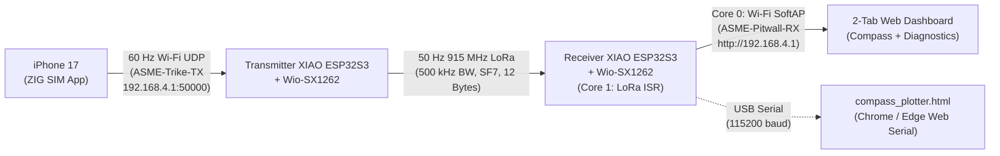

# ASME e-HPVC — High-Speed iPhone 17 (ZIG SIM) $\rightarrow$ LoRa $\rightarrow$ Receiver Dashboard & Diagnostics Test

This folder contains the complete end-to-end wireless heading and link-diagnostics pipeline from the trike-mounted **iPhone 17** to the **Pitwall Receiver** (`http://192.168.4.1` and USB Serial):



---

## 1. Folder & Arduino IDE Tab Structure

When you open either `.ino` file in the Arduino IDE, the companion `.h` files automatically appear as organized tabs across the top of the window:

```text
test_zig_lora_60hz/
├── README.md                          # Complete setup, build & architecture guide (this file)
├── compass_plotter.html               # 2-Tab Webpage (Compass + Connectivity & Diagnostics)
├── fast_build.ps1                     # Persistent-cache incremental compiler & auto-port uploader
├── upload_transmitter.bat             # One-click cached compile & upload for Transmitter
├── upload_receiver.bat                # One-click cached compile & upload for Receiver
├── zig_lora_transmitter/
│   ├── zig_lora_transmitter.ino       # Main setup() & loop() orchestration
│   ├── imu_math.h                     # 3D Quaternion reference pose lock & Euler heading math
│   ├── zig_sim_wifi.h                 # "ASME-Trike-TX" SoftAP, iPhone RSSI check, ZIG SIM UDP parser
│   └── lora_protocol.h                # Wio-SX1262 config, 12-byte packet struct & non-blocking TX ISR
└── zig_lora_receiver/
    ├── zig_lora_receiver.ino          # Main setup() & loop() orchestration
    ├── lora_protocol.h                # Wio-SX1262 config, 12-byte packet struct & Core 1 RX ISR
    ├── web_server.h                   # Core 0 "ASME-Pitwall-RX" Wi-Fi SoftAP & HTTP JSON endpoints
    └── dashboard_html.h               # 2-Tab PROGMEM HTML webpage (identical to compass_plotter.html)
```

---

## 2. Architecture & Low-Packet-Loss Engineering (`< 2%` Target)

To achieve smooth real-time heading updates while keeping packet loss under $2\%$:

1. **Dual-Core ESP32S3 Separation on the Receiver (`Core 0` vs. `Core 1`):**
   * **`Core 0` (`WebServerTask` in `web_server.h`):** Runs the `ASME-Pitwall-RX` Wi-Fi SoftAP and services HTTP requests (`/`, `/state`, `/zero`, `/reset`, `/clear_stats`) with Wi-Fi modem sleep disabled (`WiFi.setSleep(false)`).
   * **`Core 1` (`loop()` in `zig_lora_receiver.ino`):** 100% dedicated to servicing `DIO1` LoRa hardware interrupts (`processIncomingLoRaPackets()`), ensuring Wi-Fi TCP handshakes never block or drop incoming LoRa packets.
2. **Non-Blocking USB Serial (`Serial.availableForWrite() >= 128`):**
   * Both Transmitter and Receiver check TX buffer space before printing to `Serial`, preventing the ESP32S3 USB CDC buffer from stalling `loop()` when running purely on Wi-Fi without a Serial Monitor open.
3. **High-Speed LoRa RF Parameters (`~5.3 ms` Airtime at `50 Hz` / `20 ms` Interval):**
   * **Frequency:** `915.0 MHz` | **Bandwidth:** `500.0 kHz` | **Spreading Factor:** `SF7` | **Coding Rate:** `4/5` | **Preamble:** `8 symbols` | **Output Power:** `10 dBm` (prevents close-range LNA saturation on the bench while covering the full track).
4. **Compact 12-Byte Binary Packet (`LoRaHeadingPacket`):**
   * `magic` (`1B`, `0xA5`)
   * `flags` (`1B` bitmask: `FLAG_PHONE_WIFI_CONN`, `FLAG_ZIG_STREAMING`, `FLAG_HAS_QUAT`)
   * `seq` (`2B`, rolling counter incremented *only* when a packet is actually transmitted over the air)
   * `heading_x10` (`2B`, `0.0°..360.0°`), `roll_x10` (`2B`), `pitch_x10` (`2B`)
   * `zig_hz` (`1B`, measured ZIG SIM UDP packet rate on Transmitter)
   * `phone_rssi` (`1B`, iPhone Wi-Fi signal strength at Transmitter in `dBm`)

---

## 3. Fast Cached Compiling & Uploading (`upload_transmitter.bat` / `upload_receiver.bat`)

Instead of waiting 75+ seconds for the Arduino IDE to recompile `RadioLib` and the ESP32S3 core on every build, use the included scripts:

* **Double-click `upload_transmitter.bat`:** Compiles `zig_lora_transmitter` into a permanent `.build_cache/` folder on your SSD (with a live `0% -> 100%` `.o` object file progress bar), auto-detects the plugged-in XIAO ESP32S3 COM port, and flashes the board.
* **Double-click `upload_receiver.bat`:** Automatically seeds its `.build_cache/` from the Transmitter's compiled `core` and `libraries` (skipping the cold build), compiles `zig_lora_receiver` in ~20 seconds, and flashes the Receiver board.

---

## 4. Step-by-Step Setup Instructions

### Step 1: Flash Both Boards
1. Plug in the **Transmitter** XIAO ESP32S3 + Wio-SX1262 and double-click **`upload_transmitter.bat`**.
2. Plug in the **Receiver** XIAO ESP32S3 + Wio-SX1262 and double-click **`upload_receiver.bat`**.

### Step 2: Configure ZIG SIM on Your iPhone 17 (Trike Node)
1. Install **[ZIG SIM](https://apps.apple.com/us/app/zig-sim/id1112909974)** (free on the Apple App Store).
2. Connect your iPhone 17 Wi-Fi to **`ASME-Trike-TX`** (open network, no password).
3. Open **ZIG SIM** $\rightarrow$ **Settings** tab:
   * **DATA DESTINATION:** `OTHER APP`
   * **PROTOCOL:** `UDP`
   * **IP ADDRESS:** `192.168.4.1`
   * **PORT NUMBER:** `50000`
   * **MESSAGE FORMAT:** `JSON` *(or `OSC`)*
   * **MESSAGE RATE PER SEC:** `60`
4. In the **Sensor** tab, select **`QUATERNION`** only, then tap the **`Start`** tab.

---

## 5. Viewing the Receiver Dashboard & Diagnostics (`http://192.168.4.1`)

### Way A: Connect Over Wi-Fi (`ASME-Pitwall-RX`)
1. Connect your laptop or pitwall phone Wi-Fi to **`ASME-Pitwall-RX`** (open network).
2. Open **`http://192.168.4.1`** in any web browser (or open `compass_plotter.html` locally while connected to `ASME-Pitwall-RX` Wi-Fi).

### Way B: Connect Over USB Serial (`compass_plotter.html`)
1. Double-click `compass_plotter.html` in **Google Chrome** or **Microsoft Edge**.
2. Click **`🔌 USB Serial (Optional)`** and select the Receiver's COM port.

### Dashboard Tabs & Interactive Controls
* **Tab 1 — `🧭 Live Compass`:**
  * 60 fps 2D circular compass dial with rotating heading arrow and live status pills (`Phone`, `ZIG Hz`, `LoRa dBm`, `RX Hz`).
* **Tab 2 — `📡 Connectivity & Diagnostics`:**
  * **4-Stage Pipeline:** Live status cards for `📱 iPhone 17` $\rightarrow$ `📤 ZIG UDP` $\rightarrow$ `📻 915 MHz` $\rightarrow$ `📥 Pitwall RX`.
  * **Trike Link:** iPhone Wi-Fi Connected status, ZIG SIM Streaming status, ZIG SIM Update Rate (`Hz`), and iPhone Wi-Fi RSSI (`dBm` + signal bar).
  * **LoRa Link:** LoRa Link status, LoRa RSSI (`dBm` + signal bar), LoRa SNR (`dB`), LoRa Receive Rate (`Hz`), Packet Loss `%` (`lost / rx`), and Last Packet Age (`ms`).
  * **Attitude:** 3D Mounting Reference Pose Lock status and live `Heading / Roll / Pitch`.
* **Action Buttons (Work over both Wi-Fi and USB Serial):**
  * **`🎯 Zero Here ('z')`:** Locks the current heading as `0.0°`.
  * **`🧭 Compass Reset ('c')`:** Resets to the un-offset compass heading.
  * **`🔄 Reset Loss ('r')`:** Clears the Receiver's `lost` and `rx` packet counters back to `0.00% (0 lost / 0 rx)`.
