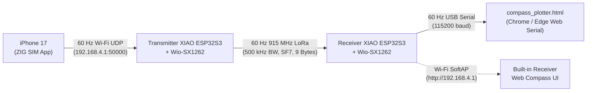

# ASME e-HPVC — 60 Hz iPhone 17 (ZIG SIM) $\rightarrow$ LoRa $\rightarrow$ Receiver Dashboard Test

This folder contains the complete end-to-end **60 Hz** wireless heading pipeline from the trike-mounted **iPhone 17** to the **Pitwall Receiver** and **2D Circular Compass Dashboard**:



---

## 1. Folder & Arduino IDE Tab Structure

When you open either `.ino` file in the Arduino IDE, the companion `.h` files automatically appear as organized tabs across the top of the window:

```text
test_zig_lora_60hz/
├── README.md                          # Complete setup & architecture guide (this file)
├── compass_plotter.html               # 2-Tab Webpage (60 Hz Compass + Connectivity & Diagnostics)
├── zig_lora_transmitter/
│   ├── zig_lora_transmitter.ino       # Main setup() & loop() orchestration
│   ├── imu_math.h                     # 3D Quaternion reference pose lock & Euler heading math
│   ├── zig_sim_wifi.h                 # "ASME-Trike-TX" SoftAP, iPhone RSSI check, ZIG SIM UDP parser
│   └── lora_protocol.h                # 60 Hz Wio-SX1262 config, 12-byte packet struct & TX ISR
└── zig_lora_receiver/
    ├── zig_lora_receiver.ino          # Main setup() & loop() orchestration
    ├── lora_protocol.h                # 60 Hz Wio-SX1262 config, 12-byte packet struct & RX ISR
    ├── web_server.h                   # "ASME-Pitwall-RX" Wi-Fi SoftAP & HTTP JSON endpoints
    └── dashboard_html.h               # 2-Tab PROGMEM HTML webpage (identical to compass_plotter.html)
```

---

## 2. How 60 Hz (`16.6 ms` Frame Budget) Works Over LoRa & Wi-Fi Simultaneously

Standard LoRa configurations (`BW = 125–250 kHz` sending ASCII text strings) take `15–75 ms` of airtime per packet—which is too slow for 60 Hz (`16.67 ms` per frame) and would block the ESP32S3 from reading incoming Wi-Fi UDP packets.

To achieve a true **60 Hz** update rate end-to-end:
1. **High-Speed LoRa RF Parameters (`~4.8 ms` Airtime):**
   * **Frequency:** `915.0 MHz`
   * **Bandwidth:** `500.0 kHz` (Halves symbol time compared to 250 kHz)
   * **Spreading Factor:** `SF7`
   * **Coding Rate:** `4/5`
   * **Preamble Length:** `6 symbols`
2. **Compact 12-Byte Binary Packet (`LoRaHeadingPacket` with End-to-End Diagnostics):**
   * Instead of ASCII strings, the transmitter sends a packed 12-byte struct (`~5.3 ms` airtime):
     * `magic` (`1 byte`, `0xA5`)
     * `flags` (`1 byte` bitmask: `Phone Wi-Fi Connected`, `ZIG SIM Streaming Active`, `3D Quaternion Pose Locked`)
     * `seq` (`2 bytes`, rolling packet counter)
     * `heading_x10` (`2 bytes`, `0..3600` $\rightarrow$ `0.0°..360.0°`)
     * `roll_x10` (`2 bytes`, `-1800..+1800` $\rightarrow$ `-180.0°..+180.0°`)
     * `pitch_x10` (`2 bytes`, `-900..+900` $\rightarrow$ `-90.0°..+90.0°`)
     * `zig_hz` (`1 byte`, measured ZIG SIM UDP packet rate on the Transmitter in `Hz`)
     * `phone_rssi` (`1 byte`, iPhone Wi-Fi signal strength at the Transmitter in `dBm`)
   * The Transmitter sends a continuous heartbeat even before ZIG SIM starts streaming so the Receiver's **Connectivity & Diagnostics** tab always shows whether the iPhone is connected to the Transmitter's Wi-Fi network.
3. **Non-Blocking `DIO1` Hardware Interrupts:**
   * `zig_lora_transmitter.ino` uses `radio.startTransmit()` with an `IRAM_ATTR` interrupt on `GPIO 39 (DIO1)`. Starting a LoRa transmission takes `< 0.3 ms` of CPU time, leaving the ESP32S3 >98% free to drain incoming 60 Hz Wi-Fi UDP packets from the iPhone without lag or dropped frames.
4. **3D Orientation-Independent Heading (`dQ_world = Q_current * conjugate(Q_ref)`):**
   * Automatically captures the iPhone's 3D mounting pose on the first Quaternion packet received and extracts horizontal rotation around the Earth's true vertical (gravity) $Z$-axis, preventing gimbal lock regardless of how the phone is mounted on the trike.

---

## 3. Hardware & Pin Mapping (Both Boards)

Both the Transmitter and Receiver use a **Seeed Studio XIAO ESP32S3** attached to a **Wio-SX1262** via the B2B connector (make sure both the **915 MHz LoRa antenna** and the **2.4 GHz Wi-Fi antenna** are connected):

| Function | ESP32S3 GPIO | Description |
| :--- | :--- | :--- |
| **`LORA_LDO_EN`** | `GPIO 38` | Wio-SX1262 Power & RF Switch Enable (driven `HIGH`) |
| **`LORA_NSS`** | `GPIO 41` | SPI Chip Select |
| **`LORA_DIO1`** | `GPIO 39` | Hardware Packet Interrupt (`TX Done` / `RX Done`) |
| **`LORA_NRST`** | `GPIO 42` | Radio Hardware Reset |
| **`LORA_BUSY`** | `GPIO 40` | Radio Busy Status Line |
| **`TCXO`** | `1.6 V` | Internal TCXO reference voltage |

---

## 4. Step-by-Step Setup Instructions

### Step 1: Flash the Transmitter Board
1. Open `zig_lora_transmitter/zig_lora_transmitter.ino` in the Arduino IDE.
2. Select **Seeed XIAO ESP32S3** as the board (`Tools -> USB CDC On Boot: "Enabled"`).
3. Upload to the **Transmitter** board.
   * Once powered on, it creates an open Wi-Fi hotspot named **`ASME-Trike-TX`** (`192.168.4.1`).

### Step 2: Flash the Receiver Board
1. Open `zig_lora_receiver/zig_lora_receiver.ino` in the Arduino IDE.
2. Select **Seeed XIAO ESP32S3** (`Tools -> USB CDC On Boot: "Enabled"`) and upload to the **Receiver** board.
3. Leave the **Receiver** board plugged into your computer via USB (and **close** the Arduino Serial Monitor / Serial Plotter so the COM port is unlocked for the web compass).

### Step 3: Configure ZIG SIM on Your iPhone 17
1. Install **[ZIG SIM](https://apps.apple.com/us/app/zig-sim/id1112909974)** (free on the Apple App Store).
2. Open **iPhone Settings -> Wi-Fi** and connect to **`ASME-Trike-TX`** (no password required).
3. Open **ZIG SIM** and go to the **Settings** tab at the bottom:

   | ZIG SIM Setting | Value |
   | :--- | :--- |
   | **DATA DESTINATION** | `OTHER APP` |
   | **PROTOCOL** | `UDP` |
   | **IP ADDRESS** | `192.168.4.1` |
   | **PORT NUMBER** | `50000` *(default)* |
   | **MESSAGE FORMAT** | `JSON` *(or `OSC` — both are supported)* |
   | **MESSAGE RATE PER SEC** | `60` |

4. Go to the **Sensor** tab in ZIG SIM and select **`QUATERNION`** (uncheck all other sensors).
5. Tap the **`Start`** tab at the bottom of ZIG SIM (allow Local Network access if prompted by iOS).
   * *Tip:* Turn your iPhone screen brightness down to `0%` while on the black `Start` screen to save battery, or use iOS **Guided Access** (triple-click side button) to disable accidental screen touches while mounted.

---

## 5. Visualizing on the Receiver (Wi-Fi Network or USB Serial — Same Webpage!)

Both the Receiver's built-in Wi-Fi web server (`http://192.168.4.1`) and `compass_plotter.html` serve the **exact same 2-Tab HTML interface**:
* **Tab 1 (`🧭 Live Compass`):** 60 Hz 2D Circular Compass with rotating heading arrow, quick status dots (`Phone`, `ZIG Hz`, `LoRa dBm`, `RX Hz`), and **`🎯 Zero Here ('z')`** / **`🧭 Compass Reset ('c')`** buttons.
* **Tab 2 (`📡 Connectivity & Diagnostics`):**
  * **4-Stage End-to-End Pipeline (`📱 iPhone 17` $\rightarrow$ `📤 ZIG UDP` $\rightarrow$ `📻 915 MHz` $\rightarrow$ `📥 Pitwall RX`)**
  * **Trike iPhone $\leftrightarrow$ Transmitter Link:** iPhone Wi-Fi Connected (`CONNECTED` / `DISCONNECTED`), ZIG SIM Streaming status (`STREAMING ACTIVE` / `PAUSED`), ZIG SIM UDP Update Rate (`Hz`), and iPhone Wi-Fi Signal Strength (`dBm` + signal meter).
  * **915 MHz LoRa Radio Link:** LoRa Link Status (`ONLINE` / `NO LORA SIGNAL`), LoRa RSSI (`dBm` + signal meter), LoRa SNR (`dB`), LoRa Receive Rate (`Hz`), Packet Loss `%` (`lost / rx`), and Last Packet Age (`ms`).
  * **Attitude & Orientation Lock:** 3D Mounting Pose Lock status, live `Heading / Roll / Pitch`, and active dashboard connection source.

### Way A: Connect Over Wi-Fi (`ASME-Pitwall-RX`)
1. Connect your laptop or pitwall phone Wi-Fi to **`ASME-Pitwall-RX`** (open network, no password).
2. Open **`http://192.168.4.1`** in any browser (or simply double-click `compass_plotter.html` while connected to `ASME-Pitwall-RX` Wi-Fi—it automatically fetches `http://192.168.4.1/state`!).

### Way B: Connect Over USB Serial (`compass_plotter.html`)
1. Double-click `compass_plotter.html` in **Google Chrome** or **Microsoft Edge**.
2. Click **`🔌 USB Serial (Optional)`** and select the **Receiver** (or Transmitter) XIAO ESP32S3 COM port.
